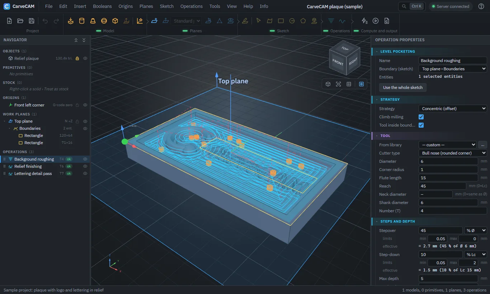

#  CarveCAM

Web-based CAM software for **mini CNC machines**: **terraced pocketing** and **projected finishing** with an end mill,
on imported 3D models and primitive solids, with free work planes in space (3+2) and G-code for your own machine.

[Download](https://github.com/SickSartori/CarveCAM/releases/latest) · [Try it online](#try-it-online-no-install) · [Manual (Italian)](docs/MANUALE.md) · [Changelog (Italian)](CHANGELOG.md) · [Italiano](README.md)



> **Work in progress (version 0.x).** Always check the G-code in your machine's simulator before cutting a part: the
> license provides no warranty.

## Try it online, no install

[](https://codespaces.new/SickSartori/CarveCAM?quickstart=1)

The button opens CarveCAM in a GitHub environment (Codespaces): it builds the program and opens the browser tab. You need
a GitHub account, a free one will do. The first start takes a couple of minutes and uses your account's free monthly
hours. It is only a trial: the codespace shuts down after a while of inactivity, so save your project to your own PC
before closing it. To work for real, install the program (see *Quick start*).

## What it is for

CarveCAM turns a 3D model into **G-code for milling**. It has two operations: **terraced pocketing**, which removes
material in layers down to the depth you set, and **projected finishing**, which follows the model's surface with the
tool. It is meant for the 3D jobs a mill does from above, like the sample project (a plaque with a raised logo) and
the engine test project (a mold with a dome and a rib): reliefs, plaques, molds and models. The same part can be machined from several sides with
**tilted work planes** (3+2). The program checks collisions, simulates the cut as the stock is removed, and writes
G-code in your machine's dialect.

## Who it is for

- **Hobbyists and makers** with a mini CNC or a 3-axis router (typically GRBL) who want to go from a 3D model to
  G-code without commercial CAM software.
- **Small workshops and labs** that machine reliefs, plaques, molds or models and want a lightweight CAM that runs on
  their own PC.
- **People learning CNC milling**: the program includes an illustrated guide and a sample project.

You need the basics of milling (work zero, tools, feeds): the program does not choose cutting parameters for you.

## Supported machines

G-code is written for a machine from the machine library; the presets can be duplicated and adapted (syntax, arcs,
spindle, coolant, tool change).

| Machine type | Preset | Notes |
|---|---|---|
| Mini CNCs and 3-axis routers running GRBL 1.1, grblHAL or FluidNC | GRBL 1.1 / grblHAL / FluidNC | GRBL-only commands, lines within 80 characters; tool changes and tilted planes become an `M0` pause with instructions in the comments |
| 3-axis mills running LinuxCNC or Mach3/Mach4 | LinuxCNC; Mach3 / Mach4 | Arcs and smooth motion (`G64`); tilted planes with an `M0` pause; `T M6` tool change on LinuxCNC, manual on Mach3 |
| Fanuc/ISO 5-axis machining centers, used in 3+2 | Fanuc / ISO 3+2 (G68.2) | Tilted planes with `G68.2`, automatic tool change and `G43` length compensation |
| 3-axis ISO controls | Fanuc / ISO 3 axes (world coordinates) | Project coordinates; with a tilted plane the tool is oriented by hand |
| Other controls | Generic G1-only, or your own machine | Linear moves only, with arcs rebuilt as chords; or CL data for an external post-processor |

## What it does not do

- It is **3-axis** milling, also with tilted planes (**3+2**: the plane is oriented, then the cut runs on three axes).
  It does not generate simultaneous 4- or 5-axis moves and the G-code does not move rotary axes.
- The operations are terraced pocketing and projected finishing: no drilling cycles, turning, laser, plasma or 3D
  printing.
- Stock is a height map per plane: undercuts relative to the tool axis are not represented. More limits in the
  [manual](docs/MANUALE.md#limiti-noti) (Italian).

## What it does

- **Operations:** terraced pocketing (concentric or zigzag; helix, ramp or plunge entry) and projected finishing, with
  collision checking of the cutting part of the tool.
- **Tools:** flat, bull-nose (torus), ball and tapered end mills built from their parameters, with a tool library,
  spindle direction (M3/M4) and climb or conventional milling.
- **Stock:** the material to remove; chained operations only cut what is left and the simulation shows the material
  being eroded.
- **Models:** STL, OBJ, PLY, OFF, glTF/GLB, FBX, 3MF, DAE, 3DS, AMF, VRML, STEP, IGES and BREP; primitive solids,
  extruded profiles and booleans; profiles derived from the 3D model.
- **G-code:** configurable machine library (GRBL 1.1 / grblHAL / FluidNC, Fanuc/ISO with `G68.2`, LinuxCNC,
  Mach3/Mach4, generic controller) with `G2`/`G3` arcs, preview and export; CL data as an alternative.
- **Also:** start screen, illustrated guide (F1), simulation, automatic backups and recovery, automatic updates,
  interface in Italian and English, light or dark theme.

It runs on your PC: a local server (VB.NET, .NET 10) and the interface in your browser (Three.js). Your data (tool
library, setups, backups, logs) stays in the `App_Data` folder next to the program.

## Quick start

**Windows 10/11, 64 bit:** download `CarveCAM-X.Y.Z-win-x64-setup.exe` from the
[Releases](https://github.com/SickSartori/CarveCAM/releases/latest) page and run it. It installs into your personal
folder (no administrator rights needed) and creates a **desktop icon** and a **Start menu** entry: open CarveCAM from
there with a double-click and the browser opens at <http://localhost:5080>. Close the black window to quit. If you
prefer not to install, use the zip `CarveCAM-X.Y.Z-win-x64.zip`: extract it to a personal folder (not
`C:\Program Files`) and double-click `CarveCAM.exe`. The program is unsigned, so Windows may warn when you open the
installer or the program: *More info › Run anyway*. If you uninstall from the Windows control panel, your data
(`App_Data`) stays in the folder. An internet connection is needed because Three.js and OpenCascade (STEP/IGES
import) load from a CDN.

**Updates:** from 0.4.1 on, while CarveCAM is open it checks GitHub for a new version and tells you (it sends no
project data). It never downloads or installs anything without your command: from *Info › Updates* you download it,
its SHA256 is verified, and you install it with a restart. Your tool library, setups, backups and `appsettings.json`
stay where they are. Turn the check off in *Options › Startup* or by setting `Update:Enabled` to `false` in
`appsettings.json`. Version 0.4.0 does not have this feature: it has to be updated by hand once.

**From source** (needs the [.NET SDK 10](https://dotnet.microsoft.com/download)):

```bash
dotnet run --project src/CarveCAM.Server/CarveCAM.Server.vbproj
```

Then open <http://localhost:5080>; change the port in `src/CarveCAM.Server/appsettings.json` (`Urls`). So far it has
only been tried on Windows.

```bash
dotnet test          # tests for the CAM engine, post-processors and importers
```

```powershell
./publish.ps1        # builds dist\CarveCAM-<version>-win-x64.zip with the self-contained executable
```

To try it right away: *Help › Sample project* creates a plaque with a logo and three operations already computed.

## Documentation

- [Manual](docs/MANUALE.md) (Italian): interface, workflow, tools, stock, operations, formats, G-code, options,
  diagnostics and known limits.
- Illustrated guide inside the program (**F1**), available in English.
- [CHANGELOG](CHANGELOG.md) (Italian).

## Repository layout

```
src/CarveCAM.Core      (VB.NET library)     geometry, mesh importers, CAM engine, post-processors
src/CarveCAM.Server    (VB.NET, ASP.NET Core) REST API + static files; wwwroot is the web interface (no build step)
tests/CarveCAM.Tests   (VB.NET, xUnit)      engine, post-processor, profile and importer tests
tools/CarveCAM.SampleProject                generator of a complete test project
tools/guide-shots.mjs                       screenshots for the guide (headless Chrome or Edge)
samples/blocco-L.stp                        sample STEP file (L-shaped block) for profiles from 3D
packaging/                                  README of the Windows package
```

## Reporting issues

Open an [issue](https://github.com/SickSartori/CarveCAM/issues) with the version (*Info › About CarveCAM*) and, if
needed, the day's log file (`App_Data/logs`; it may contain the names of the files you opened, so check it before
posting). Do not attach the *blackbox* (*Help › Export blackbox*): it contains your project and its password is public;
if needed, send it privately on request.

## License and credits

CarveCAM is released under the [MIT](LICENSE) license. Development: William Veronesi and Gabriel S. Sartori.
Third-party components (Clipper2, Three.js, three-mesh-bvh, three-bvh-csg, OpenCascade and others) have their own
licenses, listed in [THIRD-PARTY-NOTICES.md](THIRD-PARTY-NOTICES.md).
