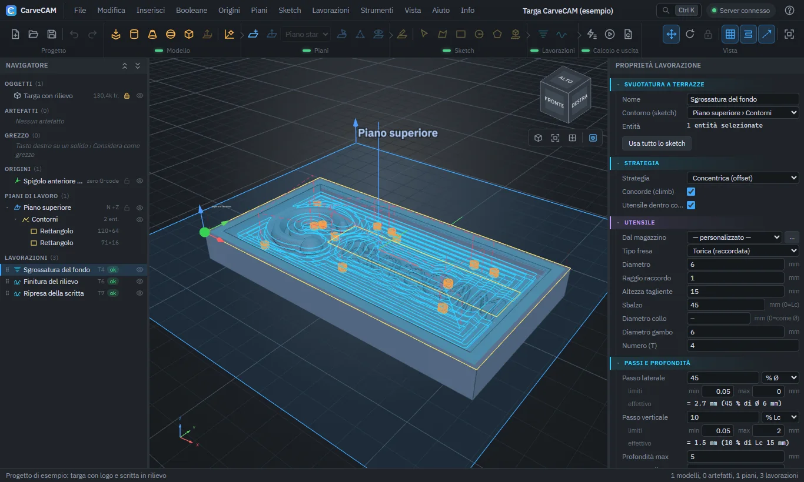

#  CarveCAM

Software CAM web per **mini CNC**: **svuotatura a terrazze** e **finitura in proiezione** con fresa, su modelli 3D
importati e su solidi primitivi, con piani di lavoro liberi nello spazio (3+2) e G-code per la tua macchina.

[Scarica](https://github.com/SickSartori/CarveCAM/releases/latest) · [Provalo online](#provalo-online-senza-installare) · [Manuale](docs/MANUALE.md) · [Novità](CHANGELOG.md) · [English](README.en.md)



> **Programma in sviluppo (versione 0.x).** Verifica sempre il G-code con il simulatore della tua macchina prima di
> lavorare un pezzo: la licenza non prevede garanzie.

## Provalo online, senza installare

[](https://codespaces.new/SickSartori/CarveCAM?quickstart=1)

Il pulsante apre CarveCAM in un ambiente di GitHub (Codespaces): compila il programma e apre la scheda del browser. Serve
un account GitHub, anche gratuito. La prima apertura richiede un paio di minuti e usa la quota mensile di ore gratuite del
tuo account.

È una **versione limitata**: si apre direttamente sul progetto di esempio (una targa con logo e tre lavorazioni già
calcolate). Puoi guardarlo da ogni lato, cambiare i parametri, ricalcolare, simulare l'erosione del materiale ed esportare
il G-code. Non si possono aprire, importare o salvare progetti. Per usare i tuoi modelli installa il programma (vedi
*Avvio rapido*).

## A cosa serve

CarveCAM trasforma un modello 3D in **G-code per fresare**. Ha due lavorazioni: la **svuotatura a terrazze**, che toglie
il materiale a strati fino alla profondità voluta, e la **finitura in proiezione**, che segue la superficie del modello
con la fresa. Serve per i lavori 3D che una fresatrice fa dall'alto, come il progetto di esempio (una targa con logo
in rilievo) e il progetto di prova del motore (uno stampo con cupola e nervatura): rilievi, targhe, stampi e modelli. Lo stesso pezzo si lavora da più
lati con **piani di lavoro inclinati** (3+2). Il programma verifica le collisioni, simula il taglio con il grezzo che
si consuma e scrive il G-code nel dialetto della tua macchina.

## A chi è rivolto

- **Hobbisti e maker** con un mini CNC o un router a 3 assi (tipicamente GRBL) che vogliono passare dal modello 3D al
  G-code senza un CAM commerciale.
- **Piccole officine e laboratori** che lavorano rilievi, targhe, stampi o modelli e cercano un CAM leggero, che gira
  sul proprio PC.
- **Chi impara la fresatura CNC**: nel programma ci sono una guida illustrata e un progetto di esempio.

Servono le basi della fresatura (zero pezzo, utensili, avanzamenti): il programma non sceglie i parametri di taglio al
posto tuo.

## Macchine supportate

Il G-code si scrive per una macchina del magazzino macchine; i preset si duplicano e si adattano (sintassi, archi,
mandrino, refrigerazione, cambio utensile).

| Tipo di macchina | Preset | Note |
|---|---|---|
| Mini CNC e router a 3 assi con GRBL 1.1, grblHAL o FluidNC | GRBL 1.1 / grblHAL / FluidNC | Solo comandi GRBL, righe entro 80 caratteri; cambi utensile e piani inclinati con pausa `M0` e istruzioni nei commenti |
| Fresatrici a 3 assi con LinuxCNC o Mach3/Mach4 | LinuxCNC; Mach3 / Mach4 | Archi e movimenti smooth (`G64`); piani inclinati con pausa `M0`; cambio utensile `T M6` su LinuxCNC, manuale su Mach3 |
| Centri di lavoro Fanuc/ISO a 5 assi, usati in 3+2 | Fanuc / ISO 3+2 (G68.2) | Piani inclinati con `G68.2`, cambio utensile automatico e correttore `G43` |
| Controlli ISO a 3 assi | Fanuc / ISO 3 assi (coordinate mondo) | Coordinate del progetto; con un piano inclinato l'utensile si orienta a mano |
| Altri controlli | Generico solo G1, o una macchina tua | Solo movimenti lineari, con gli archi rifatti a corde; in alternativa CL data per un post-processor esterno |

## Cosa non fa

- È fresatura a **tre assi**, anche con piani inclinati (**3+2**: il piano si orienta e poi si lavora a tre assi). Non
  genera movimenti a 4 o 5 assi simultanei e il G-code non muove assi rotanti.
- Le lavorazioni sono la svuotatura a terrazze e la finitura in proiezione: niente cicli di foratura, tornitura, laser,
  plasma o stampa 3D.
- Il grezzo è una mappa di quote per piano: i sottosquadri rispetto all'asse utensile non sono rappresentati. Altri
  limiti nel [manuale](docs/MANUALE.md#limiti-noti).

## Cosa fa

- **Lavorazioni:** svuotatura a terrazze (concentrica o zigzag, ingresso a elica, rampa o affondo) e finitura in
  proiezione, con verifica delle collisioni della parte tagliente.
- **Utensili:** frese cilindrica, torica, sferica e conica, generate dai loro parametri, con magazzino, senso di
  rotazione (M3/M4) e lavorazione concorde o discorde.
- **Grezzo:** il materiale da togliere; le lavorazioni in catena lavorano solo il materiale rimasto e la simulazione
  mostra l'erosione.
- **Modelli:** STL, OBJ, PLY, OFF, glTF/GLB, FBX, 3MF, DAE, 3DS, AMF, VRML, STEP, IGES e BREP; artefatti primitivi,
  estrusioni di profili e booleane; profili ricavati dal modello 3D.
- **G-code:** magazzino macchine configurabile (GRBL 1.1 / grblHAL / FluidNC, Fanuc/ISO con `G68.2`, LinuxCNC,
  Mach3/Mach4, controllo generico) con archi `G2`/`G3`, anteprima ed esportazione; in alternativa CL data.
- **Comodità:** schermata iniziale, guida illustrata (F1), simulazione, copie di sicurezza e recupero, aggiornamenti
  automatici, interfaccia in italiano e inglese, tema chiaro o scuro.

Il programma gira sul tuo PC: un server locale (VB.NET, .NET 10) e l'interfaccia nel browser (Three.js). I dati
(magazzino utensili, setup, copie di sicurezza, log) restano nella cartella `App_Data` accanto al programma.

## Avvio rapido

**Windows 10/11 a 64 bit:** scarica dalla pagina [Releases](https://github.com/SickSartori/CarveCAM/releases/latest)
`CarveCAM-X.Y.Z-win-x64-setup.exe` ed eseguilo. Installa nella tua cartella personale (non servono i diritti di
amministratore), crea l'**icona sul desktop** e la voce nel **menu Start**: da lì apri CarveCAM con un doppio clic e si
apre il browser su <http://localhost:5080>. Per uscire chiudi la finestra nera. Chi preferisce non installare usa lo zip
`CarveCAM-X.Y.Z-win-x64.zip`: lo scompatta in una cartella personale (non in `C:\Programmi`) e fa doppio clic su
`CarveCAM.exe`. Il programma non è firmato, quindi Windows può avvisare all'apertura dell'installatore o del
programma: *Ulteriori informazioni › Esegui comunque*. Disinstallando dal pannello di Windows i tuoi dati (`App_Data`)
restano nella cartella. Serve una connessione a internet, perché Three.js e OpenCascade (importazione STEP/IGES) si
caricano da CDN.

**Aggiornamenti:** dalla 0.4.1, quando CarveCAM è aperto controlla da solo su GitHub se c'è una versione nuova e te lo
dice (non invia dati del progetto). Non scarica né installa nulla senza il tuo comando: da *Info › Aggiornamenti* la
scarichi, ne viene verificato l'SHA256 e la installi con un riavvio. Utensili, setup, copie di sicurezza e
`appsettings.json` restano dove sono. Si spegne in *Opzioni › Avvio* o con `Update:Enabled` a `false` in
`appsettings.json`. La 0.4.0 non ha questa funzione: va aggiornata a mano una volta.

**Dai sorgenti** (serve il [.NET SDK 10](https://dotnet.microsoft.com/download)):

```bash
dotnet run --project src/CarveCAM.Server/CarveCAM.Server.vbproj
```

Poi apri <http://localhost:5080>; la porta si cambia in `src/CarveCAM.Server/appsettings.json` (`Urls`). Finora è
stato provato solo su Windows.

```bash
dotnet test          # test del motore CAM, dei post-processor e degli importatori
```

```powershell
./publish.ps1        # crea dist\CarveCAM-<versione>-win-x64.zip con l'eseguibile autonomo
```

Per provare subito il programma: *Aiuto › Progetto di esempio* crea una targa con logo e tre lavorazioni già calcolate.

## Documentazione

- [Manuale](docs/MANUALE.md): interfaccia, flusso di lavoro, utensili, grezzo, lavorazioni, formati, G-code, opzioni,
  diagnostica e limiti noti.
- Guida illustrata nel programma (**F1**).
- [CHANGELOG](CHANGELOG.md): novità di ogni versione.

## Struttura del repository

```
src/CarveCAM.Core      (VB.NET, libreria)   geometria, importatori mesh, CAM, post-processor
  Geometry/           Vec2/Vec3, Mat4 (convenzione Three.js), PlaneFrame (piano + angoli G68.2)
  Meshes/             lettori STL (ascii/bin), OBJ, PLY (ascii/bin), OFF; tassellazione artefatti
  Cam/                DropCutter, HeightField (marching squares), PathPlanner (concentrico/zigzag),
                      CamEngine (svuotatura, finitura, verifica collisioni), Poly (Clipper2),
                      ProfileBuilder (profili da 3D: ombra proiettata e booleane)
  Post/               G-code configurabile per macchina (GRBL, ISO/Fanuc 3 assi o 3+2 con G68.2, ...), CL data APT
src/CarveCAM.Server    (VB.NET, ASP.NET Core) API REST + file statici
  Controllers/        /api/mesh (anche facce B-rep), /api/cam, /api/project, /api/profile,
                      /api/library (utensili, setup, macchine), /api/recovery (copie di sicurezza), /api/log
  Services/           archivio mesh e percorsi, log su file
  wwwroot/            interfaccia web (HTML/CSS/JavaScript con Three.js, nessun build step)
tests/CarveCAM.Tests   (VB.NET, xUnit)       test di motore, post, profili e importatori
tools/CarveCAM.SampleProject (VB.NET)       generatore del progetto di prova (vedi il manuale)
tools/guide-shots.mjs                       schermate della guida (Chrome o Edge senza finestra)
samples/blocco-L.stp                        STEP di prova (blocco a L con gradino e foro) per i profili da 3D
packaging/                                  LEGGIMI.txt del pacchetto Windows
```

## Segnalazioni

Per un problema o una proposta apri una [segnalazione](https://github.com/SickSartori/CarveCAM/issues) indicando la
versione (*Info › Informazioni su CarveCAM*) e, se serve, il file di log del giorno (`App_Data/logs`; può contenere i
nomi dei file aperti, controllalo prima di pubblicarlo). Non allegare la *blackbox* (*Aiuto › Esporta blackbox*):
contiene il progetto e la sua password è pubblica; se serve, la si invia in privato su richiesta.

## Licenza e crediti

CarveCAM è rilasciato con licenza [MIT](LICENSE). Sviluppo: William Veronesi e Gabriel S. Sartori. Le componenti di
terze parti (Clipper2, Three.js, three-mesh-bvh, three-bvh-csg, OpenCascade e altre) hanno le loro licenze, elencate
in [THIRD-PARTY-NOTICES.md](THIRD-PARTY-NOTICES.md).
